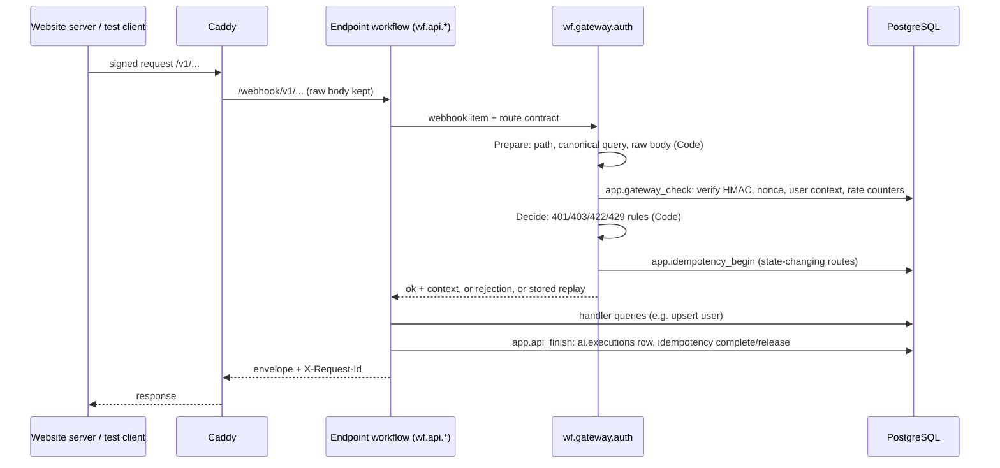
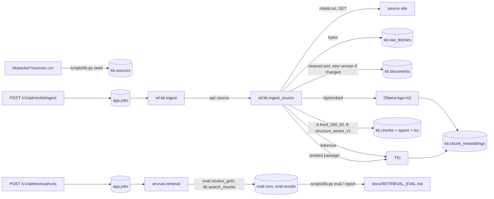
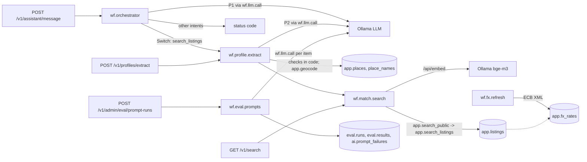
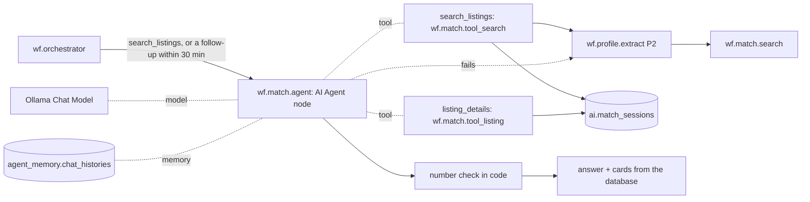
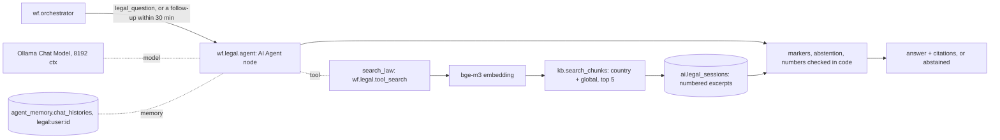
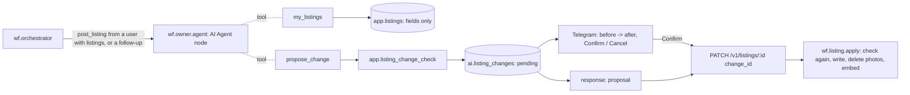
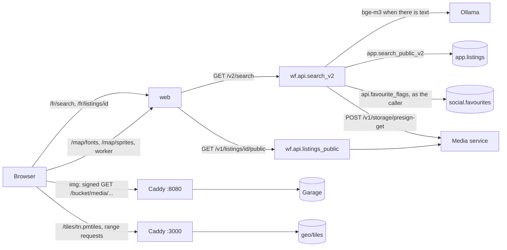
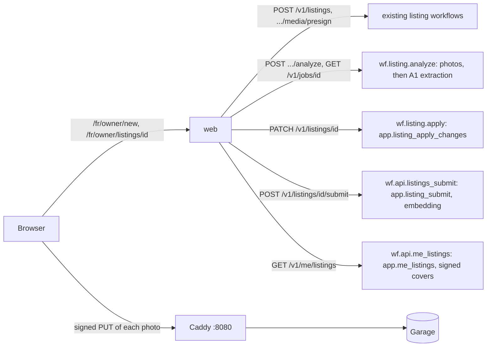

# Architecture (services as of platform P1; request paths as of phase 2)

This file describes what exists. The target architecture is in FLATSHARE_BACKEND_SPEC.md
sections 5 and 8; deviations are in DECISIONS.md.

## Services (docker-compose.yml)

| Service | Role | Reachable from |
|---|---|---|
| `proxy` (Caddy) | Public entry: `/v1/*` → n8n production webhooks (rewrites for routes with parameters generated into `routes.caddy`, D-097); envelopes n8n's own error answers; 1 MiB body limit; signed uploads with CORS for the website's origin. Second site on port 3000: the website (D-097) | host 127.0.0.1:8080 and :3000 |
| `web` (Next.js) | Website and BFF (platform P1): pages, accounts (Better Auth, database `auth`), server actions that call `/v1` signed with the `website` key. No business rules | proxy only |
| `mailpit` | Catches the website's e-mails in development (web interface :8025) | host 127.0.0.1:8025 |
| `n8n` + `n8n-runners` | All API logic: gateway, endpoints, error handler. Code nodes run in the external runner | proxy; editor on host 127.0.0.1:5678 |
| `postgres` | One server, three databases: `flatshare` (app, kb, ai, eval, sec, and the platform's api, social, home, notify schemas), `n8n` (n8n's own data) and `auth` (website accounts) | compose network |
| `garage` | S3-compatible object storage (bucket created at start) | compose network |
| `ollama` | Embeddings (bge-m3); the local LLM qwen3.5:4b for P1 to P3 and, with images, P7 (D-081) | compose network |
| `media` (FastAPI) | Photo processing (type, size, EXIF strip, hashes, blurring, metrics), presigned uploads, the smaller copy of a photo for P7 (`/v1/images/vision`), evaluation photos (`/v1/eval/photos`, keys under `eval/` only). Compute only; reads and writes objects, no database (D-070, D-071) | compose network, internal token |
| `text` (FastAPI) | Language identification (GlotLID) and PII masking with optional NER (D-074, D-075) | compose network, internal token |
| `telegram` | Long-polling relay from the Telegram Bot API to n8n's internal webhook (D-079); sends a listing's photos as one album when n8n asks (`POST /v1/send-album`, D-086) | outgoing to Telegram; 8099 on the internal network only |
| `tei` (Text Embeddings Inference, CPU) | multilingual-e5-large embeddings and the XLM-RoBERTa tokenizer used for chunking | compose network |
| one-shot: `db-bootstrap`, `n8n-setup`, `ollama-pull` | migrations, role passwords, settings, API keys; credential and workflow import; model pull | — |
| profiles: `queue` (Redis), `test` (test runner, fixture file server) | load tests later; contract and ingestion tests | — |

Not built yet: ASR service (phase 4), video frames and PDF text in the Media service (phase 4), 3D worker (phase 10).

## Request path

Three or four database calls per request, all parameterised. Secrets never pass through n8n:
the HMAC is computed inside PostgreSQL by a function `n8n_worker` can call but whose key table it cannot read.

## Workflows (n8n/workflows, generated by n8n/build.py)

| Workflow | Trigger | Does |
|---|---|---|
| `wf.gateway.auth` | sub-workflow | signature, replay, rate limit, user, role, consent, body rules, idempotency |
| `wf.api.health` | `GET /v1/health` | database, object storage, Ollama + embedding model checks |
| `wf.api.users_sync` | `POST /v1/users/sync` | create/update user, consent status |
| `wf.ops.error_handler` | Error Trigger | records unexpected workflow failures in `ai.executions` |
| `wf.api.admin_kb_ingest` | `POST /v1/admin/kb/ingest` (admin) | creates a `kb_ingest` job, starts `wf.kb.ingest`, answers 202 |
| `wf.kb.ingest` | sub-workflow (job worker) | loads the pack's sources, runs `wf.kb.ingest_source` for each, logs, finishes the job |
| `wf.kb.ingest_source` | sub-workflow | robots.txt, fetch, clean (HTML or PDF), store version, tokenize (TEI), chunk A and B, embed (Ollama, TEI; one request at a time, D-049), store |
| `wf.api.jobs_get` | `GET /v1/jobs/:id` | job status for the requester, admins and moderators |
| `wf.api.admin_eval_runs_create` | `POST /v1/admin/eval/runs` (admin) | creates an `eval_retrieval` job, starts `wf.eval.retrieval`, answers 202 |
| `wf.eval.retrieval` | sub-workflow (job worker) | resolves gold, embeds queries once per model, searches every configuration, stores per-query metrics |
| `wf.api.admin_eval_runs_get` | `GET /v1/admin/eval/runs/:id` (admin) | one run with summary and per-query metrics |
| `wf.llm.call` | sub-workflow | loads a prompt version (`ai.prompt_for`), calls Ollama `/api/chat` with the JSON Schema as `format`, validates, retries once with the errors |
| `wf.orchestrator` | `POST /v1/assistant/message` | A0: P1 router, deterministic Switch; search goes to the A3 Match agent (or, when it is off or fails, A2 then `wf.match.search`), legal questions to the A5 Legal agent, owners' changes to the owner assistant, other intents answer a status code |
| `wf.match.agent` | sub-workflow | A3 Match agent (D-084): n8n AI Agent node with the Ollama chat model, Postgres chat memory (`agent_memory.chat_histories`) and two workflow tools; system message P6 from the registry; numbers in the answer checked in code |
| `wf.match.tool_search` | sub-workflow (agent tool `search_listings`) | the agent's request through `wf.profile.extract` (P2) and `wf.match.search`; keeps the result in `ai.match_sessions`; answers the model with fields only |
| `wf.match.tool_listing` | sub-workflow (agent tool `listing_details`) | fields of one result of the conversation's last search, by number |
| `wf.legal.agent` | sub-workflow | A5 Legal agent (D-087): AI Agent node, Ollama chat model (8,192-token context), own chat memory (`legal:user:<id>`), one tool; system message P5 from the registry; citations, abstention and numbers checked in code |
| `wf.legal.tool_search` | sub-workflow (agent tool `search_law`) | the agent's query embedded (bge-m3), `app.legal_search` (`kb.search_chunks`, country plus global sources), excerpts numbered for the conversation in `ai.legal_sessions` |
| `wf.owner.agent` | sub-workflow | Owner assistant (D-088): AI Agent node, Ollama chat model, own chat memory (`owner:user:<id>`), tools `my_listings` and `propose_change`; proposes, never writes |
| `wf.owner.tool_listings` / `wf.owner.tool_change` | sub-workflows (agent tools) | the user's listings, numbered (`app.owner_listings`); a change checked and stored as pending (`app.owner_change_propose`, `ai.listing_changes`) |
| `wf.listing.apply` | sub-workflow | writes a change (`app.listing_apply_changes`, or a confirmed proposal), deletes removed photos from storage, embeds again when needed |
| `wf.api.listings_patch` | `PATCH /v1/listings/:id` | the owner changes fields, or applies a proposal with `{change_id}` |
| `wf.profile.extract` | sub-workflow | A2: P2, amounts converted to minor units from P2 v3 (`lib/money.js`, D-066), deterministic checks (allowed preferences, currency), anchor geocoded |
| `wf.match.search` | sub-workflow | A3 (search part): embeds the text query (bge-m3), `app.search_public` |
| `wf.api.search` | `GET /v1/search` | filters, optional text, optional saved profile |
| `wf.api.profiles_extract` | `POST /v1/profiles/extract` | `wf.profile.extract`, optionally saves |
| `wf.api.profiles_me` | `PUT /v1/profiles/me` | validates and saves the profile (`app.save_profile`) |
| `wf.api.admin_eval_prompt_runs_create` | `POST /v1/admin/eval/prompt-runs` (admin) | creates an `eval_prompts` job, starts `wf.eval.prompts` |
| `wf.eval.prompts` | sub-workflow (job worker) | golden set of P1 or P2 for versions x models, one item at a time; results, summaries, `ai.prompt_failures` |
| `wf.api.admin_listings_embed` / `wf.listings.embed` | `POST /v1/admin/listings/embed` (admin) / worker | embeds listings without an embedding, 16 texts per request, one request at a time |
| `wf.api.admin_fx_refresh` / `wf.fx.refresh` | `POST /v1/admin/fx/refresh` (admin) and weekdays 17:10 / worker | ECB reference rates into `app.fx_rates` |
| `wf.test.fail` | `GET /v1/test/fail` | test-only, throws; imported only with `N8N_IMPORT_TEST_WORKFLOWS=1` |

## Database roles

| Role | Used by | Can |
|---|---|---|
| `postgres` | migrations, bootstrap | everything |
| `n8n_app` | n8n itself | owns database `n8n` only |
| `n8n_worker` | workflows (credential "Flatshare DB (n8n_worker)") | CRUD on app/kb/ai/eval, bypasses RLS, calls `sec.verify_request`; cannot read `sec.api_clients` |
| `api_user` | reserved for a future API layer | RLS-limited reads and owner-limited writes; three functions |
| `sec_owner` | owns `sec.*` | no login |
| `app_rls` | owns the platform functions in `api` (D-096) | no login, no BYPASSRLS: RLS filters every row its functions touch; table rights on `social`, `home`, `notify` |
| `auth_app` | the website's accounts | owns database `auth` only; nobody else may connect to it |

## Knowledge base (phase 2)

Compute stays outside n8n only where n8n cannot do it: tokenization and e5 embeddings (TEI), bge-m3 embeddings (Ollama), search and storage (PostgreSQL functions). Cleaning, structure parsing, chunking and metrics are plain JavaScript in `kb/` and `eval/lib/`, inlined into Code nodes by `n8n/build.py` and unit-tested with `node --test`.

## Profile and search (phase 3)

### Match agent (D-084)

The agent decides when to search, rewrites follow-ups into a full request and writes a short answer. The search
itself is the fixed path (P2 with its checks, then `app.search_public`); the cards shown to the user come from the
database, not from the model's text, and an answer with a number that no tool gave is dropped.

### Legal agent (D-087)

The model writes plain text with [n] after each claim, `[NOT_FOUND]` or `[CONFLICT]`; code keeps only markers of
excerpts that were retrieved, builds the citations (title, URL, type, reliability, article, retrieval date) from the
database, and abstains when nothing valid is cited or a number is in no excerpt. Telegram adds the notice.

### Owner assistant (D-088)

Every LLM call except the agents' goes through `wf.llm.call`: the template and schema come from the registry, the model
from `llm.default_model` unless the caller names one. Agent steps (prompt version, model, tokens,
latency, errors; never the request text) are written to `ai.agent_steps` with the request record by
`app.api_finish`. Search, money conversion, geocoding and location fuzzing are PostgreSQL functions
(migration 0008); scoring of prompt outputs is `eval/lib/prompt_metrics.js`, inlined into the worker.

## Website and platform layer (platform P1, docs/PLATFORM_SPEC.md)

```mermaid
flowchart LR
  B[Browser] -->|https, port 3000| C[Caddy :3000]
  C -->|X-Forwarded-For| W[web: Next.js pages + server actions]
  W -->|sessions| ADB[(auth database)]
  W -->|signed /v1 call, X-Client-Ip| P[Caddy :8080]
  P --> G[wf.gateway.auth] --> E[wf.api.* platform workflow]
  E -->|select api.fn&#40;user, input&#41;| F[api functions, owner app_rls]
  F -->|RLS on app.current_user_id| T[(social, home, notify tables)]
  B -->|signed PUT, CORS for WEB_ORIGIN| P --> S[(Garage)]
  W -->|SMTP| M[Mailpit]
```

- Every page renders on the server. Forms post to server actions; each calls one API operation with an idempotency
  key generated when the page was shown. The browser never sees the API key and never calls n8n.
- Platform workflows (`n8n/build_platform.py`) all have the same nodes: webhook, route, gateway, shared validator
  with the endpoint's rules, one `api.*` call, result, envelope. The `api` functions set the caller first, so the
  forced RLS policies of the platform tables decide which rows exist for the caller (D-096). `n8n_worker` has no
  privilege on those tables.

| Workflow | Route | Function |
|---|---|---|
| `wf.api.me_get` | `GET /v1/me` | `api.me` |
| `wf.api.profiles_get` | `GET /v1/profiles/me` | `api.profile_get` |
| `wf.api.notifications_list` | `GET /v1/me/notifications` | `api.notifications_list` |
| `wf.api.notifications_read` | `POST /v1/me/notifications/read` | `api.notifications_read` |

Notifications are written by workflows with `api.notify_emit(user, type, params, link)`; the website writes the text
in the reader's language.

### Search, listing page, favourites, map (platform P2, D-099 to D-101)

| Workflow | Route | Does |
|---|---|---|
| `wf.api.search_v2` | `GET /v2/search` | validator (`lib/search2_query.js`), saved profile when asked, query embedding, `app.search_public_v2`, the caller's favourites among the results (`api.favourite_flags`), signed cover URLs from the Media service, cursor for the next page |
| `wf.api.listings_public` | `GET /v1/listings/{id}/public` | `app.listing_public_view` (published, or the caller's own), favourite flag, signed photo URLs |
| `wf.api.favourite_put`, `wf.api.favourite_delete` | `PUT`, `DELETE /v1/me/favourites/{listing_id}` | `api.favourite_put`, `api.favourite_delete` (row-level layer) |
| `wf.api.favourites_list` | `GET /v1/me/favourites` | `api.favourites_list` (row-level layer), then `app.public_cards` and cover photos |
| `wf.api.listing_change_cancel` | `POST /v1/listing-changes/{id}/cancel` | `app.listing_change_cancel_request`: 200, 404 or 409 with the reason |

- Photos never leave the storage without a signature: the Media service signs a GET for keys under `media/` only
  (processed copies), for `media.photo_url_ttl_s` seconds; the proxy passes signed `GET`/`HEAD` under `media/` and
  nothing else of the bucket except signed upload `PUT`s.
- The map's data, fonts, icons and worker all come from our own origins. The country file is cut on the owner's PC
  (`scripts/windows/map.ps1`); without it the search page shows the list only.
- The website's assistant page uses the same orchestrator and agents as Telegram, then `GET /v2/search?ids=` to show
  the result cards.

### Owners: posting, publication, my listings (platform P3, D-102)

| Workflow | Route | Does |
|---|---|---|
| `wf.api.listings_submit` | `POST /v1/listings/{id}/submit` | `app.listing_submit`: 404 for another owner's listing, 409 while an analysis runs or for a listing that is not a draft, 422 with what is missing (`app.listing_readiness`: rent, place on the map, a photo), else published with its title and map point, owner notified (`listing_published`), then embedded for the search by meaning |
| `wf.api.me_listings` | `GET /v1/me/listings` | `app.me_listings`: the owner's listings with their number for the owner assistant, what each draft still needs, the analysis issues that still apply, the last analysis job, the actions that apply; cover photos signed by the Media service |

- The browser uploads photo bytes straight to the storage with the presigned URLs; the website server only asks for
  the URLs and starts the analysis job, then follows it with `GET /v1/jobs/{id}`.
- A new analysis keeps what the owner changed: `app.store_listing_extraction` skips the columns named in
  `extraction.owner_changes` and keeps that history and the publication record (D-077's open point).
- Archive and publish again stay `PATCH /v1/listings/{id}` with `status`. From P8 the trust job replaces the direct
  publication in `app.listing_submit`.
- The owner assistant panel on `/owner/listings` is the assistant page's chat; its numbers ("annonce 2") match the
  `number` the list shows.

### Messages, visits, applications, reports (platform P4, D-103)

```mermaid
flowchart LR
  W[web: listing page, /messages, /visits, /applications] -->|signed calls| G[wf.gateway.auth]
  G --> E[19 wf.api.* platform workflows]
  E -->|select api.fn&#40;user, input&#41;, as app_rls| F[api functions]
  F -->|RLS: members, parties| T[(social.conversations, members, messages, blocks, visit_slots, visits, visit_events, applications)]
  F --> R[(app.reports)]
  F -->|api.notify_emit| N[(notify.notifications)]
```

- Each operation is one `api.*` function; the policies of the `social` tables decide what exists for the caller.
  Membership checks inside policies go through `social.my_conversations()` and `social.slot_taken()` (superuser-owned
  helpers that only answer about the caller or a count).
- The function returns the actions the caller can take on a visit or an application; the pages show those buttons.
- `tests/contract/test_isolation.py` runs every conversation, visit and application operation as a third user.

### Households (platform P5 and P6, D-104, D-105)

- Schema `home`, behind the row-level layer: households, members, invites, expenses and shares, settlements,
  recurring items, rent payments, announcements (P5); chores and assignments, shopping, house rules, events, issues
  (P6). Each operation is one `api.*` function, as in P4.
- Arithmetic in SQL: `api.split` (the three split modes), `api._balances` and `api.settle_plan` (suggested
  settlements); pure functions, tested on their own.
- `wf.household.daily` (05:00 UTC) calls `home.daily_reminders()`: rent and bill reminders in each household's date,
  once per due date; P6 adds the chore assignments.

## Flatmates and saved searches (platform P7)

- Tables `social.flatmate_profiles`, `social.saved_searches`, `social.saved_search_hits` (migration 0028), behind the
  row-level layer. A profile is visible to others only when its owner says so and nobody blocked anybody.
- `social.compatibility(a, b)` computes the score and the factor states from an allowlist of profile fields (D-106);
  the API returns it with each profile and, on the owner side, with applications to a household's room.
- `POST /v1/households/{id}/room-posts` -> `home.room_post`: a draft listing linked to the household, finished on the
  owner pages.
- `POST /v1/me/saved-searches` checks the query with the `/v2/search` code; `wf.household.daily` (05:00 UTC) runs
  reminders, then chores, then `social.daily_alerts()`, which sends each new matching listing once per search.
- Website: `/flatmates`, `/flatmates/[id]`, `/flatmates/me`, `/saved-searches`; "Save this search" on `/search`;
  "A room is free" on the household page.

## Trust and safety (platform P8)

- Submit: `wf.api.listings_submit` -> `app.listing_submit(user, id)` (P3 checks; 100 when the trust check is on) ->
  `wf.trust.assess` -> `app.listing_submit(user, id, {report_id})`: published, `pending_review` with a moderation item,
  or rejected (D-107).
- `wf.trust.assess`: `app.trust_facts` (database signals), the phrase lists of the packs (Code node), the Trust agent
  A4 (AI Agent node, `P4_trust_assessor`, tools in `wf.trust.tool`), `trust_rules.checkAgent` (quotes, payment
  confirmation), `app.trust_store` -> `app.trust_score` (caps, verdict) -> `app.trust_reports`.
- `wf.ops.benchmarks` (04:30 UTC) -> `app.refresh_price_benchmarks()` -> `app.price_benchmarks`.
- Moderation: `GET /v1/admin/moderation`, `POST /v1/admin/moderation/{id}/decision` -> `app.moderation_list`,
  `app.moderation_decide` (staff only, audit log). Reports open or raise queue items (trigger on `app.reports`).
- Messages: `wf.api.message_send` scans the text with the phrase lists; codes in `social.messages.flags`, shown to the
  receiver as `warnings`.
- Badges: `app.user_badges`, in `GET /v1/me`. Website: `/admin/moderation`, badges on `/account`, warnings in a
  conversation, the trust outcome on the owner's publish step.

## Documents and legal help (platform P9)

- `GET /v1/document-templates` -> templates built from `kb/templates` (Code node). `POST /v1/households/{id}/documents`
  -> `api.document_facts` (membership, role, confirmed payment) -> `doc_fill` (slots, escaping) -> Media service
  `POST /v1/pdf/render` (WeasyPrint, `documents/...`) -> `api.document_store` -> `home.documents`.
  `GET /v1/documents/{id}` signs a download URL; the website's `/[locale]/documents/{id}/download` redirects to it.
- Document agent A6: `POST /v1/households/{id}/documents/assistant` -> AI Agent node with `wf.documents.tool`
  (`household_facts`, `template_slots`, `propose_document` -> `home.document_drafts`); confirmed with `{draft_id}`.
- `POST /v1/legal/ask` -> Text service masking -> `wf.legal.agent` (A5), no router.
- Website: `/households/[id]/documents` (forms per type, the agent, the list with downloads).

## Moving out and privacy (platform P10)

- Deposits and move-out: `home.deposits`, `home.move_outs` behind the row-level layer; `api.deposits_list`,
  `api.deposit_put`, `api.moveout_get|start|item`; leave checks the balance (`api.household_leave`).
- `GET /v1/documents/{id}/comparison` -> `api.document_comparison` (the two inventories' stored rows).
- `DELETE /v1/me` -> `app.me_erase` -> `app.erase_user` and the erasure triggers of every phase; files as
  `delete_media` jobs. `wf.ops.retention` (03:30 UTC): `app.retention_run`, then `app.media_deletions_take` -> Media
  service `POST /v1/storage/delete` -> `app.media_deletions_done`.
- Website: `/households/[id]/move-out`, `/households/[id]/documents/[doc]` (comparison), "Delete my account" on `/account`.

## Notification channels and admin (platform P11)

- `wf.notify.dispatch` (every minute): `app.deliveries_take` -> Compose (website sentences, `lib/notify_text.js`) ->
  Send Email (SMTP credential) / Telegram node -> `app.deliveries_done` (`notify.deliveries`, retries).
- `GET|PUT /v1/me/notification-preferences` (`notify.preferences`); `POST|DELETE /v1/me/telegram-link`
  (`app.telegram_link_codes`, hash only); `wf.telegram.link` for the bot (`app.telegram_link_redeem`).
- Admin: `/v1/admin/settings` (allowlist), `/v1/admin/users`, `/v1/admin/users/{id}/role`, `/v1/admin/prompts`,
  `GET /v1/admin/eval/runs`, `/v1/admin/kb/sources` -> `app.admin_*` (role checked in SQL and by the gateway).
- Website: notification settings and Telegram code on `/account`; `/admin` and its pages.

## Hardening (platform P12)

- `tests/contract/test_isolation_matrix.py`: every resource path of `docs/openapi.yaml`, called by an outsider.
- `web/tests/safety.test.ts`: no raw HTML, only `lib/server/api.ts` reaches the API, no extra write routes.
- `wf.kb.ingest_source`: "Robots URL" -> "Address allowed?" (`lib/url_guard.js`, `kb.fetch_allow_hosts`) -> fetch,
  or "Refused (address)" with no request.
- Backup: `scripts/db-backup.sh` / `db-restore.sh` with `db-fingerprint.sql` (run in the db-bootstrap container by
  `scripts/windows/backup.ps1`, `restore.ps1`, `p12.ps1`); Garage volumes as a tar. Load: `scripts/load_bench.py`.
  Status: `docs/HARDENING.md`.

## Submit with the trust check as a job (D-112)

- `POST /v2/listings/{id}/submit` (`wf.api.listings_submit_v2`) -> `app.listing_submit_job` -> 202 and a
  `listing_trust` job, started at once in `wf.listing.trust` (retries: `wf.jobs.dispatch`) -> `wf.trust.assess` ->
  `app.listing_submit` with the report -> embedding -> `app.job_finish` (outcome) and `app.record_job_steps`.
- The website's publish panel uses v2 and polls `GET /v1/jobs/{id}`. `POST /v1/listings/{id}/submit` is unchanged.

## Trust check: detector mode and contact reuse (D-114)

- `wf.trust.assess`: Rules -> Agent? (trust.model agent) -> Trust agent | Detector? (trust.model detector) -> one
  `wf.llm.call` of `P8_scam_detector` -> Check answer (same quote checks; `price_mismatch` from its amounts) -> Store.
- `app.trust_facts` = `app.trust_facts_base` + `contact_reused` (`app.trust_contact_reuse`). Moderation items carry the
  check's `note`.

## Flatmate matching from Yosr's branch (D-115)

- Contact: `api.contact_request_create` / `contact_requests_list` / `contact_request_decide` on
  `social.contact_requests`; accept -> `direct` conversation + `contact_request_accepted` notification.
- `wf.api.flatmate_explain`: Facts (`api.flatmate_explain_facts`) -> Plan -> Model? -> `wf.llm.call`
  (`P12_match_explainer`) -> Build result (`checkSentence`, else `codeSentence`).
- `wf.api.flatmate_assistant`: AI Agent A7 (Ollama, Postgres memory, tools via `wf.flatmate.tool`) -> Session text ->
  Check answer (`checkProposal`, `supportedByText`) -> `{answer, proposal, dropped}`; saved only by
  `app.flatmate_onboarding_apply`.
- Living plan: `api.document_facts` = `document_facts_base` + costs, chores, habits (`home.living_plan_habits`).
- Website: `/contact-requests`, contact and "why this score" on `/flatmates/[id]`, the chat on `/flatmates/me`, the
  living plan form on the household documents page.

## Website interface (D-116)

- Design tokens and shared utilities: `web/app/globals.css` (light, dark by system, dark or light by `data-theme`).
- Theme: `components/theme-toggle.tsx` sets the `theme` cookie and `data-theme`; `app/[locale]/layout.tsx` reads the
  cookie for the first paint; `components/search/search-map.tsx` restyles the map on the `themechange` event.
- Shell: `components/site-header.tsx` (one `<nav>`, `nav-link.tsx`, `header-menu.tsx`), `components/site-footer.tsx`.
- Shared pieces: `components/ui/field.tsx` (`PageHeader`, `Empty`, `Notice`), `components/ui/avatar.tsx`,
  `components/ui/assistant.tsx` (every assistant: thinking, turns, dashed proposal box).
- Home page texts: `landing` namespace in `web/messages/*.json` (the `home` namespace belongs to the household pages).

## Country of the site (D-118)

- `web/lib/server/country.ts` (cookie `country`), `components/country-switcher.tsx`; used by the search, flatmates,
  assistant, new listing and new household pages.
- GET /v1/places -> `wf.api.places_list` -> `api.places_list` -> `app.places_for` (database owner; the gazetteer).
